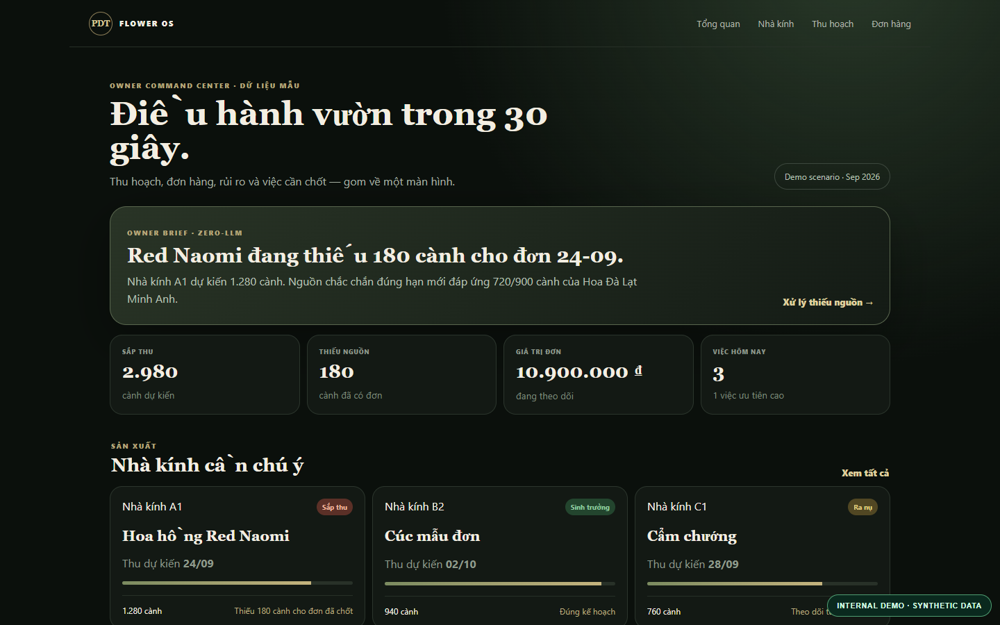
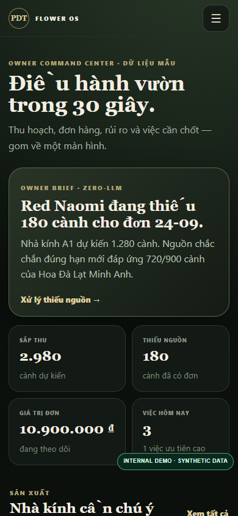
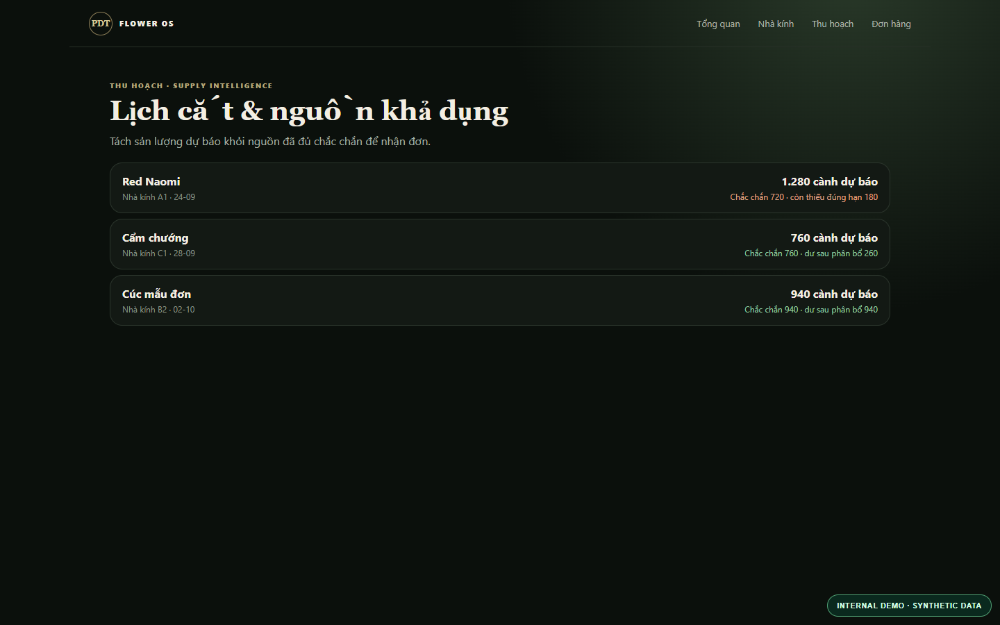

# PDT Flower Operations — Grower Dashboard Demo

A mobile-first **Next.js + React + TypeScript** dashboard prototype for flower growers and greenhouse operators.

> Self-initiated PDT LABS internal demo. All greenhouses, crops, supply lots, orders, demand values and reported metrics are synthetic. **Not a paid client project or a live deployed farm system.**

## Preview







## Features demonstrated

- Grower command center: work priorities and greenhouse status
- Harvest planning and demand matching
- Example orders and crop inventory reporting
- Domain logic for lot allocation, fulfillment gaps and revenue-at-risk calculations
- Responsive owner-first navigation

## Run

Requires Node.js 22+.

```bash
npm install
npm run dev
```

Then open http://localhost:3000.

## Test and build

```bash
npm run test:domain
npm run typecheck
npm run build
```

See `docs/VALIDATION.md` for verified results. No actual farm data, paid integrations, real-time weather, cloud storage, authentication or production workflow are included.

## Technical origin

The showcase is a curated copy from PDT LABS' **private Flower OS project**. The source repository was left untouched and private. Only prototype app, synthetic data and local domain logic are included.

The project source is visible for technical review but is **not licensed for reuse**. Third-party dependencies retain their own licenses.
